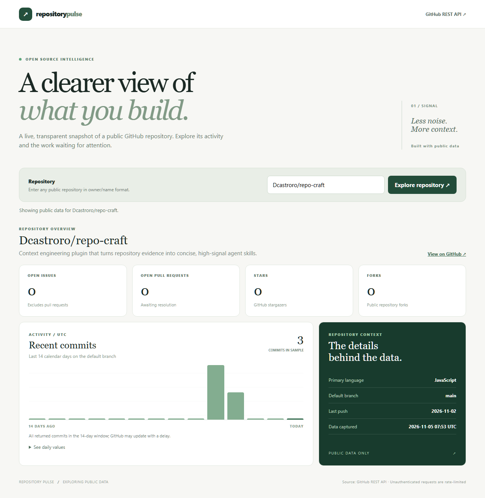

# Repository Pulse

A lightweight, browser-based dashboard for exploring real public GitHub repository activity and open work. It queries the GitHub REST API directly from your browser; no account, token, database or external charting package is required.

[Explore the live demo](https://dcastroro.github.io/repository-pulse/)

The screenshot is an example captured at a point in time; the running dashboard fetches current data.

## Run

Requires Node.js 20+. Run `npm start` and open http://127.0.0.1:4174. Enter a public repository such as `Dcastroro/repo-craft` and select **Explore repository**. Run `npm test` for the data transformation tests.

## Metrics and limits

- Open issue and PR counts come from separate GitHub Search API queries, avoiding GitHub's combined `open_issues_count` field. Counts reflect GitHub's search index and can lag or change.
- Stars, forks, language, default branch and last push come from the repository endpoint.
- The bar chart groups commits from the default branch into 14 inclusive UTC calendar days by committer date. The request returns at most 100 commits; the interface labels a full page as potentially truncated. It does not represent every branch or every kind of contribution.
- Public unauthenticated API requests are rate-limited by GitHub. API errors, missing repositories and rate limits are shown in the interface rather than replaced with fabricated data. Requests are made directly from the browser and GitHub receives the requested repository and your IP address.
- Daily values are available as a text table as well as a chart. The application does not persist the repository name or data.

This is an exploratory dashboard, not a judgment of a project's quality or a complete engineering-performance measurement.
